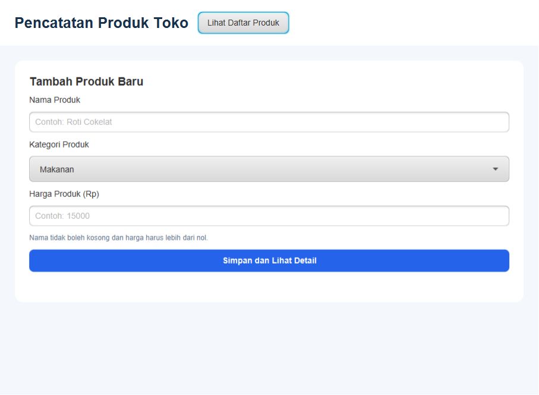
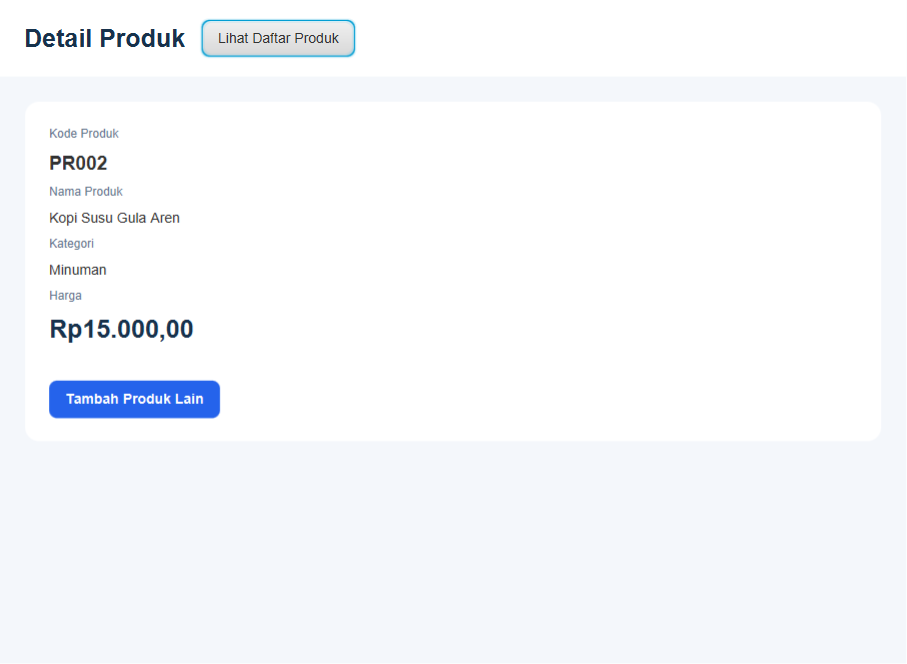
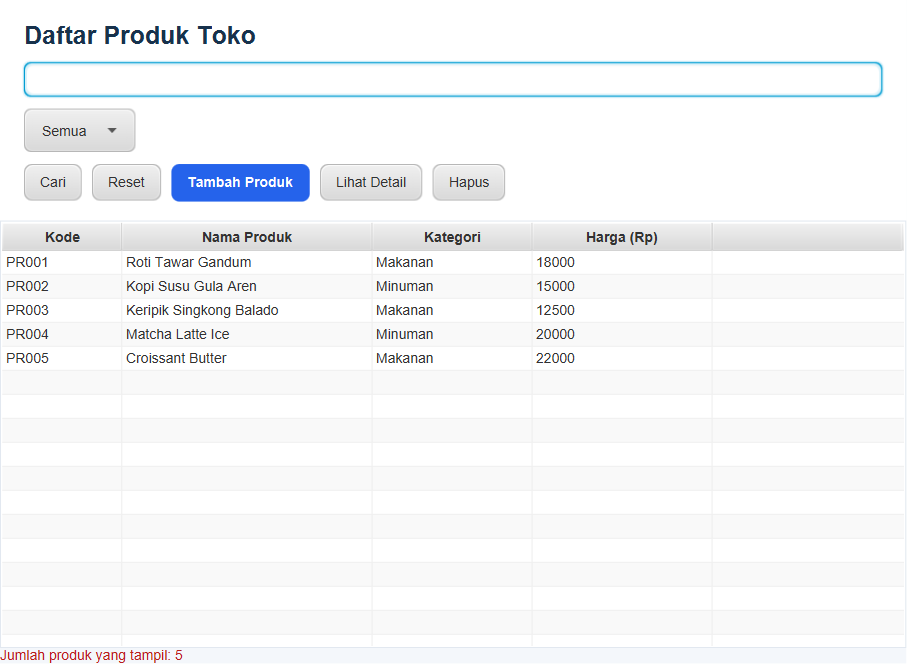
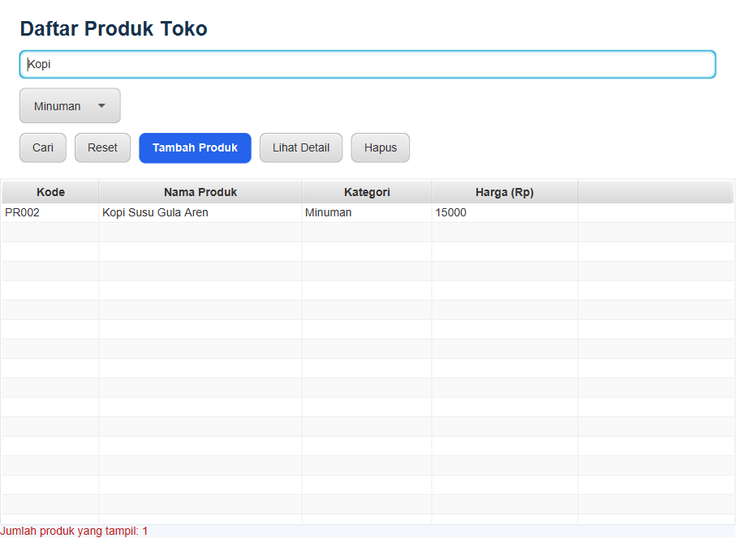

<div align="center">

# 🛒 ProdukTokoApp
### Sistem Pencatatan & Manajemen Produk Toko Berbasis JavaFX

[](https://www.oracle.com/java/)
[](https://openjfx.io/)
[](https://maven.apache.org/)
[](LICENSE)

<p align="center">
  Aplikasi desktop modern untuk mengelola inventaris dan pencatatan produk toko secara interaktif. Dibangun menggunakan arsitektur <b>Model-View-Controller (MVC)</b> dengan <b>JavaFX FXML</b> dan styling kustom CSS.
</p>

</div>

---

## 📑 Daftar Isi
- [Tentang Aplikasi](#-tentang-aplikasi)
- [Tangkapan Layar (Screenshots)](#-tangkapan-layar-screenshots)
- [Fitur Utama](#-fitur-utama)
- [Arsitektur & Struktur Direktori](#-arsitektur--struktur-direktori)
- [Teknologi yang Digunakan](#-teknologi-yang-digunakan)
- [Prasyarat Sistem](#-prasyarat-sistem)
- [Panduan Menjalankan Aplikasi](#-panduan-menjalankan-aplikasi)
- [Panduan Upload ke GitHub](#-panduan-upload-ke-github)
- [Kontribusi & Lisensi](#-kontribusi--lisensi)

---

## 💡 Tentang Aplikasi

**ProdukTokoApp** dirancang untuk memudahkan pelaku usaha atau staf toko dalam mencatat, mencari, dan meninjau informasi produk secara cepat dan efisien. Aplikasi ini mengimplementasikan validasi input yang ketat pada sisi model dan form guna menjamin integritas data (nama produk tidak boleh kosong, kategori wajib dipilih, dan harga harus berupa bilangan bulat positif lebih dari nol).

---

## 📸 Tangkapan Layar (Screenshots)

Berikut adalah dokumentasi antarmuka pengguna (UI) dari aplikasi ProdukTokoApp:

### 1. Form Tambah Produk Baru
Halaman utama untuk menginputkan data produk dengan validasi otomatis.
<p align="center">
  
</p>

---

### 2. Halaman Rincian / Detail Produk
Menampilkan detail produk yang baru disimpan lengkap dengan kode produk ter-generate otomatis (`PR001`, `PR002`, dst.) dan nominal harga dalam format mata uang Rupiah (`id-ID`).
<p align="center">
  
</p>

---

### 3. Daftar Produk Toko (TableView)
Tabel interaktif yang menyajikan seluruh daftar produk yang tersimpan dengan opsi aksi cepat (*Tambah*, *Lihat Detail*, dan *Hapus*).
<p align="center">
  
</p>

---

### 4. Pencarian Real-Time & Filter Kategori
Penyaringan daftar produk berdasarkan kata kunci nama produk dan/atau pemilihan kategori spesifik (Makanan/Minuman) secara instan.
<p align="center">
  
</p>

---

## ✨ Fitur Utama

- **Otomatisasi Kode Produk:** Kode barang digenerate secara otomatis dengan format kode standar toko (contoh: `PR001`, `PR002`, `PR003`).
- **Validasi Data Berlapis:** Mencegah penyimpanan jika nama produk kosong atau nilai harga bernilai `<= 0`.
- **Format Rupiah Dinamis:** Tampilan harga dikonversi otomatis sesuai standar *locale* Indonesia (`Locale.forLanguageTag("id-ID")`).
- **Pencarian Cerdas & Fleksibel:** Cari produk berdasarkan sebagian teks atau seluruh nama produk tanpa memperhatikan huruf besar/kecil (*case-insensitive*).
- **Penyaringan Kategori (Filter):** Memilah produk berdasarkan kategori `Semua`, `Makanan`, atau `Minuman`.
- **Penghapusan dengan Konfirmasi:** Menghindari kehilangan data akibat ketidaksengajaan klik melalui dialog konfirmasi `Alert.AlertType.CONFIRMATION`.
- **Desain UI Modern & Responsif:** Antarmuka dengan kartu (*card layout*), tombol tematik, dan styling CSS eksternal (`app.css`) yang nyaman dipandang.
- **Navigator Terpusat:** Pengaturan perpindahan antar *scene* (Form ⇄ Detail ⇄ Daftar) yang rapi menggunakan kelas `Navigator`.

---

## 📂 Arsitektur & Struktur Direktori

Proyek ini menerapkan konsep **Separation of Concerns (SoC)** menggunakan pola MVC:

```text
ProdukTokoApp/
├── .gitignore                          # Konfigurasi file yang diabaikan Git
├── nbactions.xml                       # Konfigurasi aksi NetBeans IDE
├── pom.xml                             # Konfigurasi dependensi Maven
├── README.md                           # Dokumentasi proyek
├── screenshots/                        # Tangkapan layar untuk dokumentasi
│   ├── 01_form_tambah_produk.png
│   ├── 02_detail_produk.png
│   ├── 03_daftar_produk.png
│   └── 04_pencarian_dan_filter.png
└── src/
    ├── main/
    │   ├── java/kelas/
    │   │   ├── controller/             # Controller JavaFX (Event Handling)
    │   │   │   ├── DaftarController.java
    │   │   │   ├── DetailController.java
    │   │   │   └── FormController.java
    │   │   ├── data/                   # Data Access / Store
    │   │   │   └── DataProduk.java
    │   │   ├── model/                  # Entity & Data Validation
    │   │   │   └── Produk.java
    │   │   ├── DemoTerminal.java       # Pengujian model mandiri via terminal
    │   │   ├── MainApp.java            # Entry point aplikasi JavaFX
    │   │   └── Navigator.java          # Pengatur transisi antar scene/layar
    │   └── resources/kelas/
    │       ├── styles/
    │       │   └── app.css             # Tema styling antarmuka
    │       ├── daftar.fxml             # Layout antarmuka daftar produk
    │       ├── detail.fxml             # Layout antarmuka detail produk
    │       └── form.fxml               # Layout antarmuka form produk
    └── test/java/kelas/
        └── ScreenshotGenerator.java    # Utilitas pembangkit screenshot otomatis
```

---

## 🛠️ Teknologi yang Digunakan

| Komponen | Teknologi | Deskripsi |
| :--- | :--- | :--- |
| **Language** | Java 17+ / 21 | Bahasa pemrograman utama |
| **GUI Framework** | JavaFX 21 | Komponen UI (`javafx-controls`, `javafx-fxml`) |
| **Build Tool** | Apache Maven | Manajemen dependensi dan siklus build proyek |
| **Styling** | JavaFX CSS | Tampilan kustom modern (`app.css`) |
| **Connector** | MySQL Connector/J 8.0.33 | Dependensi siap pakai untuk integrasi database |
| **IDE Support** | Apache NetBeans / IntelliJ / VS Code | Kompatibel dengan semua IDE populer |

---

## 📋 Prasyarat Sistem

Sebelum menjalankan proyek, pastikan komputer Anda telah terpasang:
1. **JDK (Java Development Kit) versi 17 atau lebih baru** (disarankan JDK 21).
   - Periksa instalasi: `java -version`
2. **Apache Maven 3.8+** (jika menjalankan melalui terminal / CLI).
   - Periksa instalasi: `mvn -version`

---

## 🚀 Panduan Menjalankan Aplikasi

### Opsi 1: Menjalankan melalui Terminal / Command Prompt
1. Buka terminal pada folder proyek `ProdukTokoApp`.
2. Jalankan perintah Maven berikut:
   ```bash
   mvn clean javafx:run
   ```

### Opsi 2: Menjalankan melalui Apache NetBeans IDE
1. Buka NetBeans IDE.
2. Pilih menu **File** > **Open Project...** lalu arahkan ke folder `ProdukTokoApp`.
3. Klik kanan pada nama proyek di panel *Projects*, lalu pilih **Run** (atau tekan tombol `F6`).

### Opsi 3: Menjalankan melalui IntelliJ IDEA / VS Code
1. Buka folder `ProdukTokoApp` sebagai **Maven Project**.
2. Buka panel Maven dan jalankan target:
   `Plugins` > `javafx` > `javafx:run`
   *atau* langsung jalankan method `main()` pada berkas `src/main/java/kelas/MainApp.java`.

### Pengujian Model via Terminal:
Untuk melakukan verifikasi logika validasi model data tanpa membuka antarmuka GUI:
```bash
mvn test-compile exec:java -Dexec.mainClass="kelas.DemoTerminal"
```

---

## 📤 Panduan Upload ke GitHub

Jika Anda ingin mengunggah proyek ini ke repositori GitHub pribadi Anda, ikuti langkah-langkah mudah di bawah ini:

### 1. Inisialisasi Git & Tambahkan Berkas
Buka Command Prompt atau PowerShell di dalam folder proyek, lalu jalankan:
```bash
# Inisialisasi repositori Git lokal
git init

# Tambahkan seluruh berkas ke staging area
git add .

# Buat commit pertama
git commit -m "feat: inisialisasi project ProdukTokoApp dengan JavaFX dan dokumentasi"
```

### 2. Hubungkan ke Repositori GitHub
Hubungkan repositori lokal ke GitHub dan lakukan *push*:
```bash
# Ubah branch utama menjadi main
git branch -M main

# Tambahkan remote origin
git remote add origin https://github.com/haidar394/ProdukToko.git

# Push kode ke GitHub
git push -u origin main
```

> **Catatan:** Berkas `.gitignore` sudah otomatis disediakan agar folder *build* seperti `/target` tidak ikut terunggah ke repositori.

---

## 👨‍💻 Kontribusi & Lisensi

Proyek ini dibuat untuk keperluan pembelajaran praktikum pemrograman berorientasi objek / pemrograman lanjut. Silakan melakukan *fork*, modifikasi, dan pengembangan lebih lanjut.

Dilisensikan di bawah lisensi [MIT](LICENSE).

